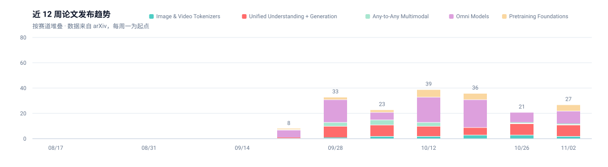
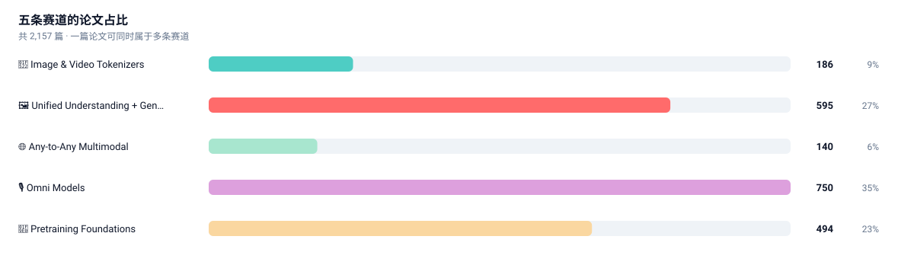

# Awesome Native Multimodal Models [](https://awesome.re)

<picture>
  <source media="(prefers-color-scheme: dark)" srcset="assets/banner-dark.svg">
  
</picture>

**自动跟踪「原生多模态模型」的开源情报站。**

聚焦五条主线——**图像/视频分词器**、**统一理解+生成**、**Any-to-Any**、**Omni 实时交互**、
**预训练底座**。每天由 GitHub Actions 从 arXiv 与 GitHub 抓取、打分、去重、归类，
自动更新论文清单、项目增速榜和周报；架构分类树与时间线仍由精选数据驱动。

[](https://github.com/isLinXu/awesome-native-multimodal-models/commits)
[](https://github.com/isLinXu/awesome-native-multimodal-models/actions/workflows/track.yml)
[](https://github.com/isLinXu/awesome-native-multimodal-models/actions/workflows/deploy.yml)
[](LICENSE)
[](scripts)
[](CONTRIBUTING.md)
[](.github/workflows/track.yml)

| 收录论文 | 近 7 天新论文 | 跟踪仓库 | 累计 star |
| --: | --: | --: | --: |
| <!--STATS:papers-->2,168<!--/STATS:papers--> 篇 | <!--STATS:papers_new-->+22<!--/STATS:papers_new--> | <!--STATS:repos-->82<!--/STATS:repos--> 个 | <!--STATS:stars-->232,040<!--/STATS:stars--> |

> 最后自动更新：<!--STATS:updated-->2026-11-14<!--/STATS:updated-->

🔗 **相关仓库：**
[Awesome-Unified-Multimodal-Models](https://github.com/AIDC-AI/Awesome-Unified-Multimodal-Models) ·
[Awesome Visual Reasoning](https://github.com/isLinXu/awesome-visual-reasoning) ·
[Awesome-Multimodal-LLMs](https://github.com/BradyFU/Awesome-Multimodal-Large-Language-Models)

---

## 什么是 Native Multimodal？

**Native Multimodal Models** 在统一架构里同时处理文本、图像、音频、视频，而不是在冻结 LLM 上加视觉 adapter。

| 维度 | Native Multimodal | Modular MLLM |
|------|-------------------|--------------|
| Tokenization | 统一 token 空间 | 各模态独立编码器 |
| Computation | 共享 Transformer | 冻结 LLM + adapter |
| Training | 端到端跨模态预训练 | 两阶段 adapter 微调 |
| Generation | 原生多模态输出 | 常常要外接 decoder |
| 例子 | Chameleon, Emu3, Janus-Pro, BAGEL | LLaVA, InstructBLIP, MiniGPT-4 |

```
模型是否处理多种模态？
     │
     ├── 否  → 不是多模态模型
     │
     └── 是  → 是否使用统一 token 空间（视觉 token ↔ 文本 token）？
                   │
                   ├── 否  → Modular MLLM（LLaVA / MiniGPT-4 / InstructBLIP）
                   │
                   └── 是  → 是否做端到端跨模态训练？
                                 │
                                 ├── 否  → Hybrid（CLIP 式对比学习）
                                 │
                                 └── 是  → Native Multimodal
```

## 赛道地图

```
                    ┌─────────────────────────────────────┐
                    │     🧠 预训练底座 (Pretraining)       │
                    │   CLIP / BLIP-2 / Flamingo / LLaVA  │
                    └─────────────────┬───────────────────┘
                                      │ 配方与视觉塔
              ┌───────────────────────┼───────────────────────┐
              │                       │                       │
     ┌────────▼────────┐     ┌────────▼────────┐     ┌────────▼────────┐
     │ 🔢 视觉分词器     │     │ 🖼️ 统一理解+生成 │     │ 🌐 Any-to-Any    │
     │ VQ / FSQ / 1D   │────▶│ AR / 解耦 / 混合 │────▶│ 任意模态进出     │
     └────────┬────────┘     └────────┬────────┘     └────────┬────────┘
              │                       │                       │
              └───────────┬───────────┴───────────┬───────────┘
                          │                       │
                   ┌──────▼──────┐         ┌──────▼──────┐
                   │ 🎙️ Omni     │         │ 交互可视化   │
                   │ 实时全双工   │         │ 分类树/时间线 │
                   └─────────────┘         └──────────────┘
```

| 赛道 | 一句话 | 文档 | 必读 | 文档内条目 |
| :-- | :-- | :-- | --: | --: |
| 🔢 **Image & Video Tokenizers** | 先把像素变成能进 Transformer 的词 | [tokenizers.md](docs/tokenizers.md) | 5 | <!--STATS:cat_tokenizers-->186<!--/STATS:cat_tokenizers--> 篇 |
| 🖼️ **Unified Understanding + Generation** | 同一个模型既要看懂，也要画出来 | [unified-ug.md](docs/unified-ug.md) | 6 | <!--STATS:cat_unified-ug-->598<!--/STATS:cat_unified-ug--> 篇 |
| 🌐 **Any-to-Any Multimodal** | 任意模态进，任意模态出 | [any-to-any.md](docs/any-to-any.md) | 4 | <!--STATS:cat_any-to-any-->140<!--/STATS:cat_any-to-any--> 篇 |
| 🎙️ **Omni Models** | 能看、能听、能说，而且要跟得上 | [omni.md](docs/omni.md) | 3 | <!--STATS:cat_omni-->756<!--/STATS:cat_omni--> 篇 |
| 🧠 **Pretraining Foundations** | 统一架构不是从零长出来的 | [pretraining.md](docs/pretraining.md) | 5 | <!--STATS:cat_pretraining-->496<!--/STATS:cat_pretraining--> 篇 |

## 怎么用

| 你想…… | 去哪 |
| :-- | :-- |
| 30 秒知道最近在发生什么 | [自动周报](docs/digest.md) |
| 看架构怎么分叉 | [观测台](https://islinxu.github.io/awesome-native-multimodal-models/) · [论文库](https://islinxu.github.io/awesome-native-multimodal-models/papers.html) · [周报](https://islinxu.github.io/awesome-native-multimodal-models/digest.html) · [仓库](https://islinxu.github.io/awesome-native-multimodal-models/repos.html) · [分类树](https://islinxu.github.io/awesome-native-multimodal-models/taxonomy.html) · [时间线](https://islinxu.github.io/awesome-native-multimodal-models/timeline.html) |
| 搞懂某条赛道 | 上面五个赛道文档，每篇都有按 arXiv ID 校验过的必读清单 |
| 找能直接跑的项目 | [项目雷达](docs/projects.md)，按 7 日 star 增速排 |
| 翻旧的精选表 | [人工精选目录](docs/catalog.md) |
| 自己改跟踪方向 | 改 [`config/taxonomy.yml`](config/taxonomy.yml)，不用动代码 |

## 现在什么情况

两张图都由 `scripts/render_charts.py` 从 `data/*.json` 直接渲染，随每天的抓取自动重画。

<picture>
  <source media="(prefers-color-scheme: dark)" srcset="assets/trend-dark.svg">
  
</picture>

<picture>
  <source media="(prefers-color-scheme: dark)" srcset="assets/distribution-dark.svg">
  
</picture>

## 自动化是怎么跑的

```
        ┌──────────────────────────────────────────────────────────────┐
        │  GitHub Actions · 每天 01:30 UTC（也可手动触发）               │
        └───────────────────────────┬──────────────────────────────────┘
                                    ▼
   ┌────────────────┐   ┌────────────────────┐   ┌────────────────────┐
   │ fetch_arxiv.py │   │  track_github.py   │   │ update_metadata.py │
   │  arXiv 检索     │   │  仓库搜索 + star    │   │  统计 / 徽章 / 周报 │
   │  HF Daily 热度  │   │  快照 + 增速计算    │   │  跨文档计数         │
   └───────┬────────┘   └─────────┬──────────┘   └─────────┬──────────┘
           │  打分·归类·去重        │  历史累积              │
           ▼                      ▼                       ▼
   docs/*.md 标记表格        data/repos.json          README 数字
   data/papers.json         (每日 star 快照)          docs/digest.md
           │                      │
           └──────────┬───────────┘
                      ▼
          ┌───────────────────────┐
          │   render_charts.py    │  ← 把 JSON 直接画成 SVG
          │   横幅 / 趋势 / 占比 /  │     不截图、不存位图
          │   各赛道 sparkline     │     浅色深色各一套
          └───────────┬───────────┘
                      ▼
                 assets/*.svg
                      │
                      ▼
        有变更才 commit（幂等，重跑无副作用）
```

六个设计取舍：

1. **标记块写入，而不是字符串定位。** 表格被 `<!-- table:start xxx -->` 包住，脚本只动块内，正文随便你改。
2. **状态外置到 `data/*.json`。** 去重靠历史库而不是靠「文档里有没有这一行」。
3. **按 arXiv ID 校验必读清单。** ID 失效或指向别的论文会被自动剔除。
4. **打分而非关键词硬匹配。** 强/中/弱三档关键词 × 标题/摘要两个位置加权，阈值可调。
5. **增速算不出来时用日均折算，而不是退回总 star。** 建库首日标 `≈`，满 7 天后切回实测值。
6. **自动化负责召回，人工负责精确剔除。** `github_blocklist` 只放确定离题的仓库。

精选模型（分类树 / 时间线 / 排行榜）仍以 `scripts/data.py` 为单一数据源，走原来的校验与 GitHub Pages 构建。自动跟踪覆盖长尾新论文，两者分开、互不覆盖。

## 快速开始

```bash
git clone https://github.com/isLinXu/awesome-native-multimodal-models.git
cd awesome-native-multimodal-models
pip install -r requirements.txt

# 0) 用已有精选清单灌入基线（可重复跑）
python scripts/seed_from_catalog.py

# 1) 校验并填充各赛道的「奠基与必读」
python scripts/seed_classics.py

# 2) 抓论文（历史回填到原生多模态概念出现之前，约 2017 / VQ-VAE）
python scripts/fetch_arxiv.py --since 2017-01-01 --sources arxiv
#    日常增量：python scripts/fetch_arxiv.py

# 3) 跟踪仓库（建议带 token，未认证搜索限流 10 次/分钟）
GITHUB_TOKEN=ghp_xxx python scripts/track_github.py

# 4) 刷新统计、徽章与周报
python scripts/update_metadata.py

# 5) 重画图表
python scripts/render_charts.py

# 6) 自检
python scripts/check_md.py

# 7) 精选可视化（可选）
python scripts/validate.py
python scripts/generate_taxonomy.py
python scripts/generate_timeline.py
python scripts/generate_index.py
python scripts/generate_papers.py
python scripts/generate_digest.py
python scripts/generate_repos.py
```

常用参数：

```bash
python scripts/fetch_arxiv.py --dry-run
python scripts/fetch_arxiv.py --category unified-ug --days 30
python scripts/fetch_arxiv.py --sources arxiv
python scripts/track_github.py --top 40 --skip-search
python scripts/render_charts.py --weeks 16
```

## 想加一条赛道 / 换个方向？

全部逻辑由 [`config/taxonomy.yml`](config/taxonomy.yml) 驱动：

```yaml
categories:
  - id: my-new-track
    name: "My Track"
    emoji: "🧪"
    doc: "docs/my-new-track.md"
    arxiv_queries: ['all:"your query"']
    github_queries: ["your repo query"]
    keywords:
      strong: ["exact term"]
      medium: ["related term"]
      weak:   ["loose term"]
    classics:
      - {id: "2405.09818", expect: "chameleon", note: "为什么必读"}
```

## 贡献

欢迎三类贡献：**补经典论文**（带 arXiv ID）、**加仓库到种子列表**、**修分类关键词**。
精选模型请改 `scripts/data.py` 并跑 `python scripts/validate.py`。
详见 [CONTRIBUTING.md](CONTRIBUTING.md)。

## 引用

```bibtex
@misc{awesome-native-multimodal-models,
  title  = {Awesome Native Multimodal Models},
  author = {Xu Lin},
  year   = {2026},
  url    = {https://github.com/isLinXu/awesome-native-multimodal-models}
}
```

## 免责声明

论文标题、作者、摘要来自 arXiv API，仓库 star 数来自 GitHub API，均保留原始来源链接。
自动归类基于关键词打分，**不保证每条都归到最优赛道**——它更擅长「不漏」，而不是「完美分类」。
分数仅代表关键词相关度，不代表论文质量。

## License

[MIT](LICENSE) · 内容版权归各论文与项目作者所有。
