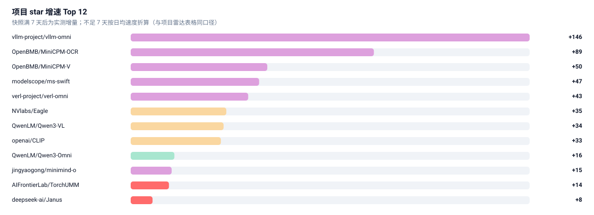

# 🚀 项目雷达 · GitHub Tracker

> 每日快照 star 数，按 **7 日增速** 排序。增速比总量更能反映「现在大家在做什么」。
> 数据来自 `data/repos.json`（含每个仓库的 star 历史），由 `scripts/track_github.py` 维护。

[← 返回总览](../README.md) · [自动周报](digest.md)

---

## 榜单口径

| 项目 | 说明 |
| :-- | :-- |
| 入选 | 配置中的种子仓库 + 按赛道关键词搜索命中（`stars ≥ 阈值`、近半年有 push、非归档、不在黑名单） |
| 排序 | 7 日 star 增量 → 30 日增量 → 总 star；**快照不足 7 天时用日均增速折算兜底** |
| `≈+N` | **估算值**：按 `总 star ÷ 仓库存活天数 × 7` 折算，不是实测增量，仅供建库首日排序参考 |
| `—` | 该窗口无法计算，也没有估算依据（如缺少创建时间） |
| `🆕` | 仓库创建于近 120 天内 |

> 为什么不用总 star 排？因为总 star 是**存量**，会把多年前的老项目顶在上面；
> 增速是**流量**，才看得出赛道当前的注意力在哪。
>
> 为什么首日要用估算兜底？因为本仓库的快照是逐日累积的，刚建库时所有仓库都只有一天记录，
> 真实 7 日增量算不出来。若此时直接按总 star 排，榜单会退化成「老牌大项目榜」，
> 刚爆发的项目永远上不来。所以用日均速度折算成 7 日估计值顶上，
> **满 7 天后自动切换为真实增量**，估算值随之消失。

## 当前榜单

先看增速，再看明细——条形长度是 7 日 star 增量，颜色是所属赛道：

<picture>
  <source media="(prefers-color-scheme: dark)" srcset="../assets/ranking-dark.svg">
  
</picture>

完整名单含语言、赛道、30 日增量：

<!-- table:start repos -->
| 排名 | 项目 | 一句话 | ⭐ | 7 日 Δ | 30 日 Δ | 语言 | 赛道 |
| --: | :-- | :-- | --: | --: | --: | :-- | :-- |
| 1 | [**vllm-project/vllm-omni**](https://github.com/vllm-project/vllm-omni) | A framework for efficient model inference with omni-modality models | ⭐ 7,807 | +145 | — | Python | `omni` |
| 2 | [**OpenBMB/MiniCPM-OCR**](https://github.com/OpenBMB/MiniCPM-OCR) 🆕 | Fast, accurate OCR with correctness assessment. | ⭐ 969 | +102 | — | TypeScript | `omni` |
| 3 | [**verl-project/verl-omni**](https://github.com/verl-project/verl-omni) | Multimodal RL training framework for diffusion & omni models | ⭐ 1,531 | +48 | — | Python | `omni` |
| 4 | [**modelscope/ms-swift**](https://github.com/modelscope/ms-swift) | Use PEFT or Full-parameter to CPT/SFT/DPO/GRPO 600+ LLMs (Qwen3.8… | ⭐ 16,115 | +40 | — | Python | `omni` |
| 5 | [**OpenBMB/MiniCPM-V**](https://github.com/OpenBMB/MiniCPM-V) | See, hear, and interact on your local devices. | ⭐ 27,158 | +38 | — | Python | `omni` |
| 6 | [**openai/CLIP**](https://github.com/openai/CLIP) | CLIP (Contrastive Language-Image Pretraining)… | ⭐ 34,620 | +33 | — | Jupyter Notebook | `pretraining` |
| 7 | [**QwenLM/Qwen3-VL**](https://github.com/QwenLM/Qwen3-VL) | Qwen3-VL is the multimodal large language model series developed by Qwen team… | ⭐ 20,223 | +33 | — | Jupyter Notebook | `pretraining` |
| 8 | [**NVlabs/Eagle**](https://github.com/NVlabs/Eagle) | Eagle: Frontier Vision-Language Models with Data-Centric Strategies | ⭐ 3,853 | +27 | — | Python | `pretraining` |
| 9 | [**jingyaogong/minimind-o**](https://github.com/jingyaogong/minimind-o) | 🎙️ A 0.1B Omni model trained from scratch, capable of listening, speaking… | ⭐ 2,735 | +24 | — | Python | `omni` |
| 10 | [**QwenLM/Qwen3-Omni**](https://github.com/QwenLM/Qwen3-Omni) | Qwen3-omni is a natively end-to-end, omni-modal LLM developed by the Qwen team… | ⭐ 4,115 | +17 | — | Jupyter Notebook | `any-to-any` |
| 11 | [**AIFrontierLab/TorchUMM**](https://github.com/AIFrontierLab/TorchUMM) | A unified multimodal model toolkit (NeurIPS'26) | ⭐ 591 | +13 | — | Python | `unified-ug` |
| 12 | [**deepseek-ai/Janus**](https://github.com/deepseek-ai/Janus) | Janus-Series: Unified Multimodal Understanding and Generation Models | ⭐ 17,772 | +11 | — | Python | `unified-ug` |
| 13 | [**OpenBMB/MiniCPM-o-Demo**](https://github.com/OpenBMB/MiniCPM-o-Demo) | Official PyTorch+CUDA Full-functional Web Demo for MiniCPM-o 4.5 | ⭐ 436 | +10 | — | Python | `omni` |
| 14 | [**1038lab/ComfyUI-QwenVL**](https://github.com/1038lab/ComfyUI-QwenVL) | ComfyUI-QwenVL custom node: Integrates the Qwen-VL series… | ⭐ 931 | +7 | — | Python | `pretraining` |
| 15 | [**ydyhello/Awesome-VLM-Streaming-Video**](https://github.com/ydyhello/Awesome-VLM-Streaming-Video) | 📚 A curated collection of papers and open-source code repositories dedicated t… | ⭐ 222 | ≈+7 | — | — | `pretraining` |
| 16 | [**ByteDance-Seed/Bagel**](https://github.com/ByteDance-Seed/Bagel) | Open-source unified multimodal model | ⭐ 6,219 | +6 | — | Python | `unified-ug` |
| 17 | [**gokayfem/awesome-vlm-architectures**](https://github.com/gokayfem/awesome-vlm-architectures) | Curated visual catalog of 200+ vision-language model (VLM/MLLM) architectures… | ⭐ 1,369 | +6 | — | Markdown | `pretraining` |
| 18 | [**lucasjinreal/Crane**](https://github.com/lucasjinreal/Crane) | A Pure Rust based LLM, VLM, VLA, TTS, OCR Inference Engine… | ⭐ 530 | +6 | — | Rust | `omni` |
| 19 | [**NVIDIA-Omniverse/usd-content-agents**](https://github.com/NVIDIA-Omniverse/usd-content-agents) | AI-powered agents for automating 3D content workflows using Vision-Language Mo… | ⭐ 247 | +6 | — | Python | `pretraining` |
| 20 | [**OpenGVLab/InternVL**](https://github.com/OpenGVLab/InternVL) | [CVPR 2024 Oral] InternVL Family: A Pioneering Open-Source Alternative to GPT-… | ⭐ 10,172 | +5 | — | Python | `pretraining` |
| 21 | [**ZJU4HealthCare/HealthGPT**](https://github.com/ZJU4HealthCare/HealthGPT) | 【ICML 2025 Spotlight】 Official Repo for Paper ‘’HealthGPT : A Medical Large Vi… | ⭐ 1,673 | +5 | — | Python | `pretraining` |
| 22 | [**Tencent-Hunyuan/UniRL**](https://github.com/Tencent-Hunyuan/UniRL) | UniRL is a Framework for Unified Multimodal Model Reinforcement Learning | ⭐ 1,050 | +5 | — | Python | `unified-ug` |
| 23 | [**appletea233/OneSearch-VL**](https://github.com/appletea233/OneSearch-VL) 🆕 | A unified multimodal deep research agent for images and videos… | ⭐ 200 | +5 | — | Python | `unified-ug` |
| 24 | [**bytedance/Lance**](https://github.com/bytedance/Lance) | A 3B-active-parameter native unified multimodal model for image and video unde… | ⭐ 1,370 | +4 | — | Python | `unified-ug` |
| 25 | [**czvvd/PartLLM**](https://github.com/czvvd/PartLLM) 🆕 | [SIGGRAPH Asia 2026 (TOG)] PartLLM: A Unified Multimodal Foundation for 3D Par… | ⭐ 162 | +4 | — | Python | `unified-ug` |
| 26 | [**mstar-project/mstar**](https://github.com/mstar-project/mstar) | A high-performance, universal serving framework for any-to-any models. | ⭐ 115 | +4 | — | Python | `any-to-any` |
| 27 | [**HarryHsing/OmniAgent**](https://github.com/HarryHsing/OmniAgent) | OmniAgent (ICML 2026): the first native omni-modal agent for active video perc… | ⭐ 90 | +4 | — | Python | `omni` `pretraining` |
| 28 | [**FoundationVision/VAR**](https://github.com/FoundationVision/VAR) | [NeurIPS 2024 Best Paper Award][GPT beats diffusion🔥] [scaling laws in visual… | ⭐ 8,770 | +3 | — | Jupyter Notebook | `tokenizers` |
| 29 | [**VectorSpaceLab/OmniGen2**](https://github.com/VectorSpaceLab/OmniGen2) | OmniGen2: Exploration to Advanced Multimodal Generation… | ⭐ 4,122 | +3 | — | Jupyter Notebook | `unified-ug` |
| 30 | [**jingyi0000/VLM_survey**](https://github.com/jingyi0000/VLM_survey) | Collection of AWESOME vision-language models for vision tasks | ⭐ 3,134 | +3 | — | — | `pretraining` |
| 31 | [**jd-opensource/JoyAI-Image**](https://github.com/jd-opensource/JoyAI-Image) | JoyAI-Image is the unified multimodal foundation model for image understanding… | ⭐ 2,244 | +3 | — | Python | `unified-ug` |
| 32 | [**EvolvingLMMs-Lab/NEO**](https://github.com/EvolvingLMMs-Lab/NEO) | NEO Series: Native Vision-Language Models from First Principles | ⭐ 928 | +3 | — | Python | `pretraining` |
| 33 | [**QwenLM/Qwen2.5-Omni**](https://github.com/QwenLM/Qwen2.5-Omni) | Qwen2.5-Omni is an end-to-end multimodal model by Qwen team at Alibaba Cloud… | ⭐ 4,097 | +2 | — | Jupyter Notebook | `omni` |
| 34 | [**bytedance/1d-tokenizer**](https://github.com/bytedance/1d-tokenizer) | This repo contains the code for 1D tokenizer and generator | ⭐ 1,179 | +2 | — | Jupyter Notebook | `tokenizers` |
| 35 | [**zhengli97/Awesome-Prompt-Adapter-Learning-for-VLMs-CLIP**](https://github.com/zhengli97/Awesome-Prompt-Adapter-Learning-for-VLMs-CLIP) | A curated list of awesome prompt/adapter learning methods for vision-language… | ⭐ 803 | +2 | — | — | `pretraining` |
| 36 | [**OpenSQZ/MiniCPM-V-CookBook**](https://github.com/OpenSQZ/MiniCPM-V-CookBook) | Cook up amazing AI applications effortlessly with MiniCPM / MiniCPM-V / MiniCP… | ⭐ 671 | +2 | — | Python | `omni` |
| 37 | [**KangLiao929/Puffin**](https://github.com/KangLiao929/Puffin) | Puffin Series: Towards Unified Multimodal 3D World Models | ⭐ 519 | +2 | — | Python | `unified-ug` |
| 38 | [**vulab-AI/Awesome-Spatial-VLMs**](https://github.com/vulab-AI/Awesome-Spatial-VLMs) | [Awesome-Spatial-VLMs] This repository is the official… | ⭐ 475 | +2 | — | Python | `pretraining` |
| 39 | [**VITA-Group/VLM-3R**](https://github.com/VITA-Group/VLM-3R) | [CVPR 2026] VLM-3R: Vision-Language Models Augmented with Instruction-Aligned… | ⭐ 456 | +2 | — | Python | `pretraining` |
| 40 | [**IBM/terramind**](https://github.com/IBM/terramind) | TerraMind is the first any-to-any generative foundation model for Earth Observ… | ⭐ 334 | +2 | — | Jupyter Notebook | `any-to-any` |
| 41 | [**roboflow/maestro**](https://github.com/roboflow/maestro) | streamline the fine-tuning process for multimodal models: PaliGemma 2… | ⭐ 2,696 | +1 | — | Python | `pretraining` |
| 42 | [**FoundationVision/LlamaGen**](https://github.com/FoundationVision/LlamaGen) | Autoregressive Model Beats Diffusion: 🦙 Llama for Scalable Image Generation | ⭐ 1,974 | +1 | — | Python | `tokenizers` |
| 43 | [**Gen-Verse/MMaDA**](https://github.com/Gen-Verse/MMaDA) | MMaDA - Open-Sourced Multimodal Large Diffusion Language Models (dLLMs with bl… | ⭐ 1,677 | +1 | — | Python | `unified-ug` |
| 44 | [**emcf/thepipe**](https://github.com/emcf/thepipe) | Get clean data from tricky documents, powered by vision-language models ⚡ | ⭐ 1,530 | +1 | — | Python | `pretraining` |
| 45 | [**EvolvingLMMs-Lab/lmms-engine**](https://github.com/EvolvingLMMs-Lab/lmms-engine) | A simple, unified multimodal models training engine… | ⭐ 834 | +1 | — | Python | `unified-ug` |
| 46 | [**OpenSenseNova/SenseNova-Vision**](https://github.com/OpenSenseNova/SenseNova-Vision) | Vision as Unified Multimodal Generation | ⭐ 730 | +1 | — | Python | `unified-ug` |
| 47 | [**gokayfem/ComfyUI_VLM_nodes**](https://github.com/gokayfem/ComfyUI_VLM_nodes) | ComfyUI nodes for vision-language models: Qwen3-VL, Moondream 3, Florence-2… | ⭐ 593 | +1 | — | Python | `pretraining` |
| 48 | [**InternRobotics/InternVLA-A-series**](https://github.com/InternRobotics/InternVLA-A-series) | InternVLA-A1: Unifying Understanding, Generation… | ⭐ 575 | +1 | — | Python | `pretraining` |
| 49 | [**GingerCohle/VLMCSHFG**](https://github.com/GingerCohle/VLMCSHFG) | This is the official code repo for "Vision-Language Models Empowered Nighttime… | ⭐ 371 | +1 | — | Python | `pretraining` |
| 50 | [**Fr0zenCrane/UniCoT**](https://github.com/Fr0zenCrane/UniCoT) | [ICLR 2026] Uni-CoT: Towards Unified Chain-of-Thought Reasoning Across Text an… | ⭐ 239 | +1 | — | Python | `any-to-any` |
| 51 | [**modelscope/mcore-bridge**](https://github.com/modelscope/mcore-bridge) | MCore-Bridge: Providing Megatron-Core model definitions for state-of-the-art l… | ⭐ 107 | +1 | — | Python | `omni` |
| 52 | [**Zihan-Su/UniMRG**](https://github.com/Zihan-Su/UniMRG) | [ICML 2026] The official implementation of paper "Generation Enhances Understa… | ⭐ 102 | +1 | — | Python | `unified-ug` |
| 53 | [**InternLM/xtuner**](https://github.com/InternLM/xtuner) | A Next-Generation Training Engine Built for Ultra-Large MoE Models | ⭐ 5,223 | 0 | — | Python | `pretraining` |
| 54 | [**NExT-GPT/NExT-GPT**](https://github.com/NExT-GPT/NExT-GPT) | Code and models for ICML 2024 paper, NExT-GPT: Any-to-Any Multimodal Large Lan… | ⭐ 3,633 | 0 | — | Python | `any-to-any` |
| 55 | [**VITA-MLLM/VITA**](https://github.com/VITA-MLLM/VITA) | ✨✨[NeurIPS 2025] VITA-1.5: Towards GPT-4o Level Real-Time Vision and Speech In… | ⭐ 2,540 | 0 | — | Python | `omni` |
| 56 | [**showlab/Show-o**](https://github.com/showlab/Show-o) | [ICLR & NeurIPS 2025] Repository for Show-o series… | ⭐ 1,986 | 0 | — | Python | `unified-ug` |
| 57 | [**OpenMOSS/AnyGPT**](https://github.com/OpenMOSS/AnyGPT) | A unified multimodal language model based on discrete sequence modeling | ⭐ 889 | 0 | — | Python | `any-to-any` `unified-ug` |
| 58 | [**facebookresearch/tuna-2**](https://github.com/facebookresearch/tuna-2) | Official implementation of Tuna-2: Pixel Embeddings Beat Vision Encoders for U… | ⭐ 763 | 0 | — | Python | `unified-ug` |
| 59 | [**zli12321/Vision-Language-Models-Overview**](https://github.com/zli12321/Vision-Language-Models-Overview) | A most Frontend Collection and survey of vision-language model papers… | ⭐ 733 | 0 | — | HTML | `pretraining` |
| 60 | [**redai-studio/Relax**](https://github.com/redai-studio/Relax) | An Asynchronous Reinforcement Learning Engine for Omni-Modal Post-Training at… | ⭐ 676 | 0 | — | Python | `omni` |
<!-- table:end repos -->

## 怎么读这张榜

- **`unified-ug` 拉起来**：通常对应一次开源统一模型发布（Janus / BAGEL / Show-o 这一档）。
- **`omni` 和 `any-to-any` 交叉**：同一仓库可能同时被两条赛道搜到，表格里会打两个标签。
- **`tokenizers` 仓库偏少**：研究密集、工程复现少，是典型的早期特征。
- **增速突然拉起的仓库**，通常对应一次模型发布或一篇高传播度论文，值得点进去看 commit 时间线。

## 想看更细的？

- 每个仓库的完整 star 历史：`data/repos.json` → `repos.<full_name>.history`
- 赛道分布与总量：`data/stats.json`
- 想加仓库：改 `config/taxonomy.yml` 的 `github_seed` 或 `github_queries`，或直接提 Issue。

---

[← 返回总览](../README.md) · [自动周报](digest.md)
